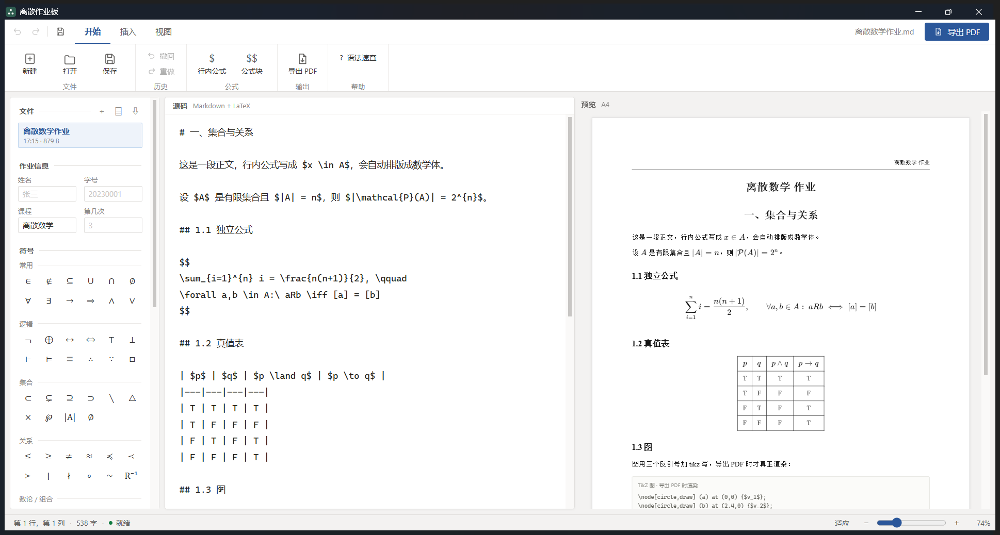

# 离散作业板 · DS-Tools

一个专门用来写离散数学作业的桌面工具。左边写 Markdown + LaTeX，右边实时预览 A4 排版，一键导出成可以直接交的 PDF。



## 为什么做这个

写离散作业绕不开这些符号：`∀ ∃ ∈ ∉ ⊆ ∪ ∩ ∅ ¬ ∧ ∨ → ⇔ ⊢ ⊨`，还要画关系图、真值表、Hasse 图。用 Word 排公式，出来的东西一眼就能看出是硬凑的；纯用 LaTeX 又要背一堆环境。

所以做了这个：**写的时候像 Markdown，排版出来是 LaTeX**。

## 功能

- **实时预览**：KaTeX 渲染，边打字边看 A4 效果
- **符号面板**：逻辑 / 集合 / 关系 / 图论 / 组合 / 希腊字母分类点选；光标在正文里时自动补 `$…$`
- **插入片段**：分式、根号、求和、矩阵、分段、真值表、证明框架，一点即入
- **画图**：` ```tikz ` 代码块，导出时渲染成矢量图
- **撤回 / 重做**：连续打字合并为一步，每次插入符号单独一步
- **文件管理**：作业统一存在 `Projects/`，侧栏列表切换、新建、删除
- **导出 PDF**：走本机 `xelatex`，中文、公式、TikZ 全部标准 LaTeX 质量
- **Office 风格界面**：功能区 + 选项卡，宽屏左右分栏、窄屏自动改上下

## 环境要求

- Windows
- [MiKTeX](https://miktex.org/) 或 TeX Live，且 `xelatex` 在 PATH 中
- 从源码构建需要 Node.js 18+

## 运行

双击 `启动.bat` 即可（会检查并调用 `dist/` 里的程序）。

## 从源码构建

```powershell
npm install
# 若 node_modules/electron/dist 不存在（postinstall 被拦）：
#   $env:ELECTRON_MIRROR='https://npmmirror.com/mirrors/electron/'
#   node node_modules/electron/install.js

powershell -ExecutionPolicy Bypass -File build.ps1
```

产物在 `dist/`，约 370 MB（Electron 运行时占大头）。

## 目录

```
操作板/
├─ 启动.bat            启动器
├─ build.ps1           打包脚本
├─ main.js             主进程：窗口、IPC、LaTeX 编译
├─ preload.js          主进程 ↔ 界面的安全桥
├─ lib/md2tex.js       Markdown 超集 → LaTeX
├─ src/                界面（HTML / CSS / JS）
├─ vendor/katex/       KaTeX（离线）
├─ 文档/                使用手册、维护手册
└─ _dev/               开发脚手架（命令行编译、图标生成、测试）
```

## 文档

- [使用手册](文档/使用手册.md)
- [维护手册](文档/维护手册.md)
- 打包下载：[离散作业板-文档.zip](离散作业板-文档.zip)

## 已知限制

- 仅针对 Windows 打包测试
- 需要本机已装 LaTeX，程序不自带发行版
- `Projects/` 与 `导出/` 属于用户数据，已加入 `.gitignore`

## 技术栈

Electron 44 · 原生 HTML/CSS/JS · KaTeX · xelatex
